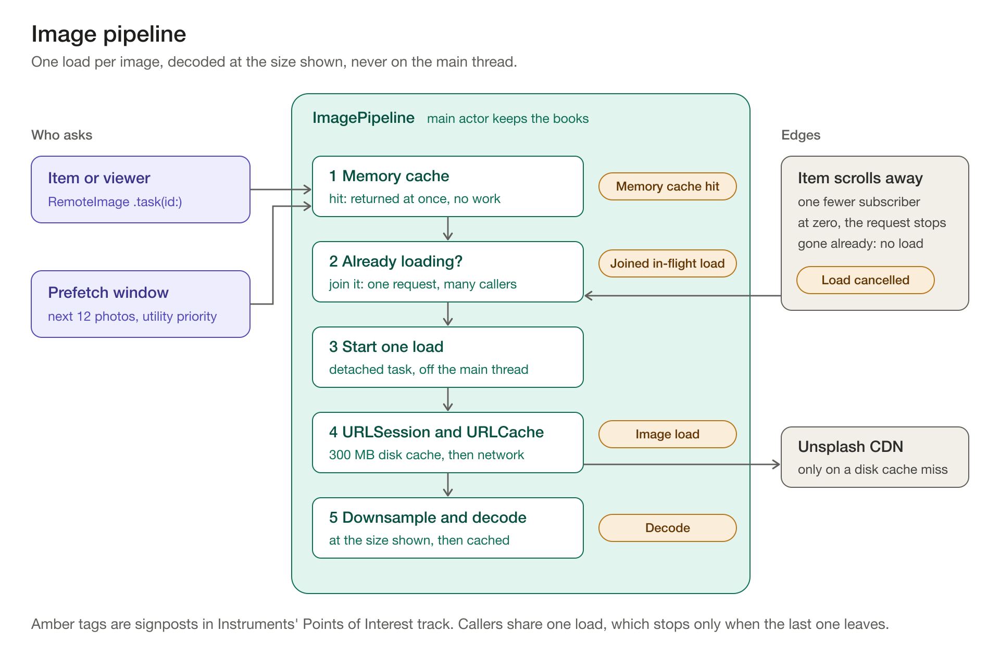

# Frames

An iOS gallery for Unsplash's Editorial feed and photo search. Photos load in an endless three-column grid, open full screen with a zoom transition and stay available offline once they've been seen.

The approach was planned before any code: [PLAN.md](PLAN.md) has the plan and [CLAUDE.md](CLAUDE.md) has the coding rules every change was reviewed against. Everything about the image pipeline, from its design to its Instruments measurements, is in [one section below](#image-pipeline-and-performance).

## Setup

1. Create an app at [unsplash.com/developers](https://unsplash.com/developers) and copy its **Access Key**.
2. Copy `Config/Secrets.example.xcconfig` to `Config/Secrets.xcconfig` and replace `your-access-key` with your key. `Secrets.xcconfig` is git-ignored, so the key never reaches the repository.
3. Open `Frames.xcodeproj`, choose the **Frames** scheme with an iPhone simulator on iOS 17 or later, then press **Run**.

Requirements: Xcode 26 and no third-party dependencies. Without a key the app shows a setup screen instead of failing requests. Every scenario below works with no key at all.

## Scenarios

Every state can be forced with a launch argument. In **Product › Scheme › Edit Scheme… › Run › Arguments**, tick one:

| Argument | What it shows |
|---|---|
| none | The live API. |
| `-scenario recorded` | Recorded API pages replayed endlessly as new photos, each repeat with its own IDs and image URLs. No key needed and no hourly limit, so it's the one for scrolling through thousands of photos and for profiling. Images still come from the CDN. |
| `-scenario slow` | Every page takes two seconds, to show the loading states. |
| `-scenario offline` | No network and nothing saved. |
| `-scenario offlineWithCache` | A saved feed with no network. Images come from the disk cache only, so run `recorded` first to fill it. |
| `-scenario rateLimited` | Two pages load, then the hourly limit is reached. |

Each scenario keeps its feed cache in memory, so one run never affects the next.

## Tests

Press **Test** (⌘U) on the **Frames** scheme, or:

```bash
xcodebuild test -project Frames.xcodeproj -scheme Frames -destination 'platform=iOS Simulator,name=iPhone 17 Pro'
```

- **Unit tests** use Swift Testing, one suite per module. Stubs record every call they receive and return results set up in advance, gates hold calls in flight and time is injected, so nothing sleeps and nothing touches the network.
- **A UI smoke test** runs the `recorded` scenario: it scrolls to the fourth page, opens and closes a photo, then searches.
- **A UI scroll test** (`ScrollProfileTests`) flicks past photo 450 and back for `scripts/profile.py`. The `Frames` scheme skips it.
- **A live contract test** decodes one real page from each endpoint and checks that every photo decoded. It runs only when your key is configured and costs two requests. The rest of the suite runs on recorded data; this is what catches the API changing underneath it.

## Architecture

```
Frames (app target)     composition root only: reads the key and launch arguments, builds dependencies
Packages/FramesKit
  FramesCore            LoadState, LoadFailure, Paginator, Router, HTTPClient. No UI.
  ImagePipeline         memory and disk caching, deduplication, cancellation, prefetching, decoding
  FramesCoreUI          shared views: RemoteImage, StatusBanner, PageFooter, photo presentation, pinch to zoom
  GalleryFeature        Photo model, Unsplash service, feed cache, view models, views, coordinator
  MockServices          recorded API pages and scenarios
  Tests/TestHelpers     stubs and builders, linked by tests only
```

Dependencies point one way: app → GalleryFeature → FramesCoreUI → ImagePipeline → FramesCore. The image pipeline knows nothing about photos, so another feature could use it unchanged. The same goes for the paginator, router and shared views.

**MVVM-C.** Views render state and send intents. `@MainActor @Observable` view models own state and logic. `GalleryCoordinator` creates the view models and owns navigation through a small generic `Router`. Every dependency is a protocol injected through `init`. Concrete types are chosen only in the composition root.

## Image pipeline and performance



The pipeline is built, not configured. No library is involved: memory cache, disk cache, deduplication, cancellation, prefetching and downsampled decoding are each a few lines. Building them is the point of the brief's bonus. `ImagePipeline` lives in its own module, knows nothing about photos or Unsplash and is reached through the `ImageLoading` protocol.

### How it works

| Technique | How | Why |
|---|---|---|
| Memory cache | `NSCache` with a cost limit in decoded bytes, sized from the device's memory (at most 150 MB). Emptied on a memory warning. | Scrolling back shows images instantly. Memory stays bounded however far the user scrolls. |
| Disk cache | A dedicated `URLSession` with its own 300 MB `URLCache`. Requests use `.returnCacheDataElseLoad`, because an Unsplash image URL never changes content. | An image seen once never goes back to the network, which is also what makes offline mode work. |
| Deduplication | One in-flight load per request, shared by every caller. | A prefetch and an item asking for the same image make one request. |
| Cancellation | Each load counts its subscribers. An item's `.task` is cancelled when it leaves the screen. The request is cancelled only when its last subscriber leaves. An item that's gone before it asks starts no load. | Flinging past photos doesn't download them. One item leaving never cancels a load another item still needs. |
| Prefetching | When an item appears, the feed asks for the next 12 photos (four rows) in the direction of scroll. The pipeline keeps one prefetch window: photos entering it load at utility priority and photos leaving it are cancelled. | Images are usually ready before their item appears. A prefetch is an ordinary subscriber, so an item that appears mid-prefetch joins it. |
| Downsampled decoding | `CGImageSourceCreateThumbnailAtIndex` decodes straight to the size the view needs, off the main thread. | The main thread never decodes during a scroll. A large image shown small never costs its full size in memory. |
| Rendition choice | Each view asks for the smallest of `thumb`, `small` and `regular` that's at least as wide as itself in pixels. A three-column iPhone item is about 400 pixels, which `small` fits exactly. | No upscaling and no wasted bytes. Returned URLs are used unchanged. |
| Bookkeeping on the main actor | The pipeline's dictionaries live on the main actor, where every caller already is. Downloads and decodes run in detached tasks off it. | Views can read the memory cache synchronously, so a cached image never flashes its placeholder. |

### Keeping SwiftUI updates cheap

The grid is a SwiftUI `LazyVGrid`, because the brief asks for SwiftUI and judges unnecessary SwiftUI updates. A `UICollectionView` would bring cell reuse and a prefetching data source, at the cost of bridging code and a UIKit justification. The prefetch window above gives the same benefit in a few lines. The work goes into keeping the grid cheap instead:

- Items (`PhotoItem`) are `Equatable` views over an `Equatable` `Photo` and are compared with `.equatable()`, so a new page creates only the new items.
- Each item's image is local `@State` inside `RemoteImage`. One image arriving redraws one item, not the grid.
- The feed view model stores `photos` apart from its load state. The grid reads only `photos`. The footer, banner and placeholder each read the state in their own small view, so a page starting to load never re-evaluates the grid.
- The grid measures its width once with a single `GeometryReader`. Items never measure themselves.
- Photo IDs are unique (the paginator drops repeats), so `ForEach` identity is stable.

### Measuring it

Every request to the pipeline leaves a signpost in Instruments' Points of Interest track (the amber tags in the diagram), so its impact can be read from one profiling run:

| Signpost | Kind | What it counts |
|---|---|---|
| Memory cache hit | event | Requests served from memory with no work at all |
| Joined in-flight load | event | Requests that shared a load already running |
| Image load | interval | Loads that went to `URLCache` or the network, with their duration |
| Decode | interval | Downsampled decodes, all off the main thread |
| Load cancelled | event | Loads stopped because every item that wanted them scrolled away |

Requests in total are hits plus joins plus loads. The share served by the memory cache and by deduplication is the work the pipeline avoided.

To reproduce the results, connect an iPhone by cable and run `scripts/profile.py <iPhone UDID> <simulator UDID>`. It builds the `FramesProfile` scheme in Release and runs `ScrollProfileTests` three times, each from a fresh install so the caches start empty. The test flicks past photo 450 and back to the top on the `recorded` scenario, which replays recorded API pages endlessly as new photos, so profiling never spends the hourly API limit while every image still comes from the CDN. It marks where scrolling starts, turns and ends with signposts of its own. The script then reads the traces and prints the table below. They stay in `build/profile` to open in Instruments.

| Run | Instruments | Gives |
|---|---|---|
| Simulator | Points of Interest | Requests, memory hits, joins, cancellations and the thread of every decode. A phone keeps only the last couple of hundred signposts per app when recording from the command line, so the simulator, which logs on the Mac, keeps the full count. |
| iPhone | HTTP Traffic and Activity Monitor | Downloads and memory. A URL's first request is a download. Later requests for it are answered by the 300 MB disk cache, which holds far more than the run downloads. |
| iPhone | Animation Hitches | Hitch time per second of scrolling. Hitch tracing is heavy, so it gets a run of its own. |

### Results

Recorded by `scripts/profile.py` on 19 October 2026, scrolling past photo 450 and back. Counts and decodes come from the iPhone 17 Pro simulator on iOS 26.0. Network, memory and hitches come from an iPhone 17 on iOS 26.6.2.

| Measure | Result |
|---|---|
| Image requests to the pipeline | 1,479 |
| Served from memory | 50% (736) |
| Joined an in-flight load | 2% (26) |
| Loads cancelled while scrolling | 2 |
| Network requests when scrolling back up | 0. The 263 images seen again came from the disk cache in a median 5 ms. |
| Memory at photo 450 and peak | 58 MB at both |
| Main-thread decode time | 0 ms. None of the 715 decodes ran on the main thread. |
| Hitch time ratio | 4.4 ms/s: 40 hitches in 145 s of scrolling, almost all one or two frames |

The one long hitch (229 ms) is a frame Instruments flags for 12 offscreen passes. It would be the first thing to look at with more time.

## Technical choices

- **One feed view model for the Editorial feed and every search.** Both endpoints map to the same `PhotoPage`, so `PhotoFeedViewModel` takes a page loader closure and serves both. Search results get the same grid, endless scroll and states for free.
- **Seamless search.** The query is debounced by 400 ms through an injected `Clock` inside `.task(id:)`, so each keystroke cancels the last search with no extra code. Clearing a search returns to the Editorial feed's same photos at the same scroll position: the feed view model stays alive and the grid restores its position with `scrollPosition(id:)`.
- **iOS 18's zoom transition, with a cross-fade on iOS 17.** The zoom comes with interactive swipe down to dismiss. iOS 17 has no zoom transition, so it cross-fades. Both live in `PhotoPresentation.swift`, the only file that checks the iOS version. The viewer also has pinch to zoom, a reusable `pinchToZoom()` modifier in FramesCoreUI. Dragging pans only while zoomed, so the tap and the swipe-down dismiss still work.
- **Offline is a saved feed plus the disk cache.** The first five Editorial pages are saved as JSON in the Caches directory and shown at launch while the feed refreshes. JSON rather than SwiftData: the data is public, read whole and never queried. Images already seen come from the disk cache with no network.
- **Swift concurrency throughout** rather than Combine: async/await, structured tasks and `.task(id:)` cover debouncing, cancellation and paging with less code and no subscriptions to manage.
- **Every failure keeps what's on screen.** Remote data is a `LoadState` whose failure case keeps the last value, so a failed page never empties the grid. Rate limiting (HTTP 403 with no requests remaining), a rejected key, being offline and server errors each get their own message.
- **Spending requests carefully.** A demo key allows 50 requests an hour, so pages are 30 photos (the maximum), search is debounced and nothing retries on its own.

## Trade-offs

- **The key ships inside the app.** That's fine for a demo. In production the app would call our own backend, which would hold the key and could cache and rate limit for every user.
- **Offline is one saved feed.** The first five Editorial pages are saved as a single JSON file, which is all one feed needs. Searches aren't saved, so search needs a connection.

## With more time

- **Full localisation.** A String Catalog with translations for every screen, plural rules for counts, right-to-left layout checks and a pseudolocalised run in the tests. The copy is already `LocalizedStringKey`, so no view needs rewriting.
- **A SwiftData store for offline.** One JSON file suits one feed. Once offline grows to saved searches, recent searches or favourites, SwiftData would let them be queried and updated in place instead of rewriting a file each time.
- **Swiping between photos in the viewer**, plus swipe down to dismiss on iOS 17, which has only the close button today.
- **A sharper image when zoomed in**, by loading Unsplash's `full` rendition once the viewer passes 2×.
- **Exact-width image URLs** built from `raw` with `w` and `dpr`, so every device downloads exactly the pixels it shows.
- **BlurHash placeholders** in place of the dominant colour, for a closer preview while an image loads.
- **Reloading when the connection returns**, using `NWPathMonitor`, instead of waiting for Retry.
- **Search suggestions, recent searches and filters** for orientation and colour, which the API already supports.
- **Snapshot tests** for every scenario.
- **A full VoiceOver and Dynamic Type audit** on a device.
- **Performance checks in CI:** XCTest metrics for memory and scroll hitches on the `recorded` scenario, with the live contract test run nightly.

## How I used AI

I set the approach before any code was written: the architecture, the module split, the image pipeline design, the scenarios and the rules in [CLAUDE.md](CLAUDE.md). Claude Code helped draft the plan and I edited it.

Claude Code then built the project step by step against the plan, running `/simplify` after each step and `/code-review` at the end. It verified every scenario on the simulator. I reviewed the code and did the Instruments profiling on a device myself.
